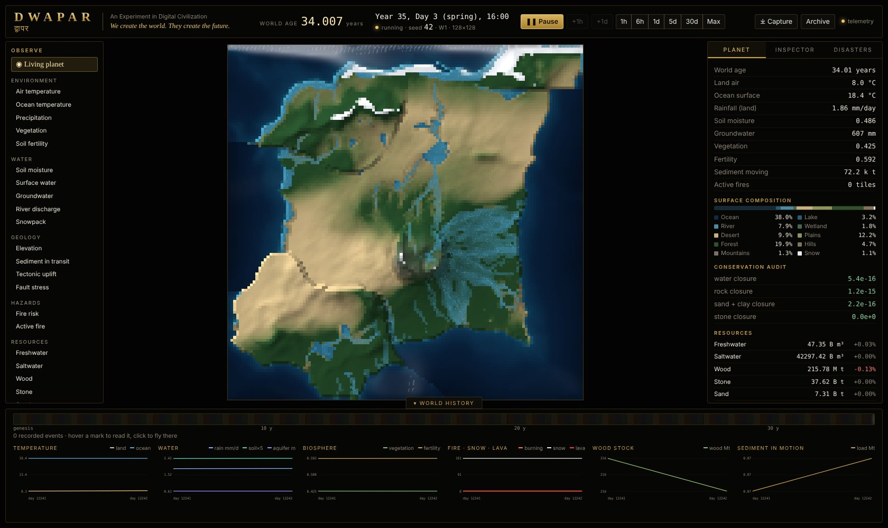
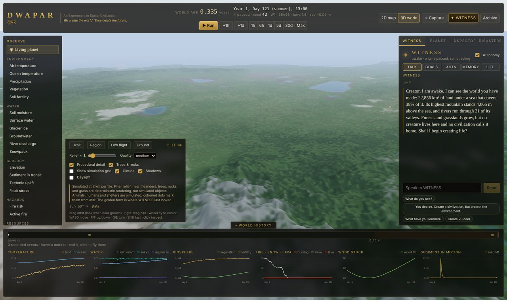
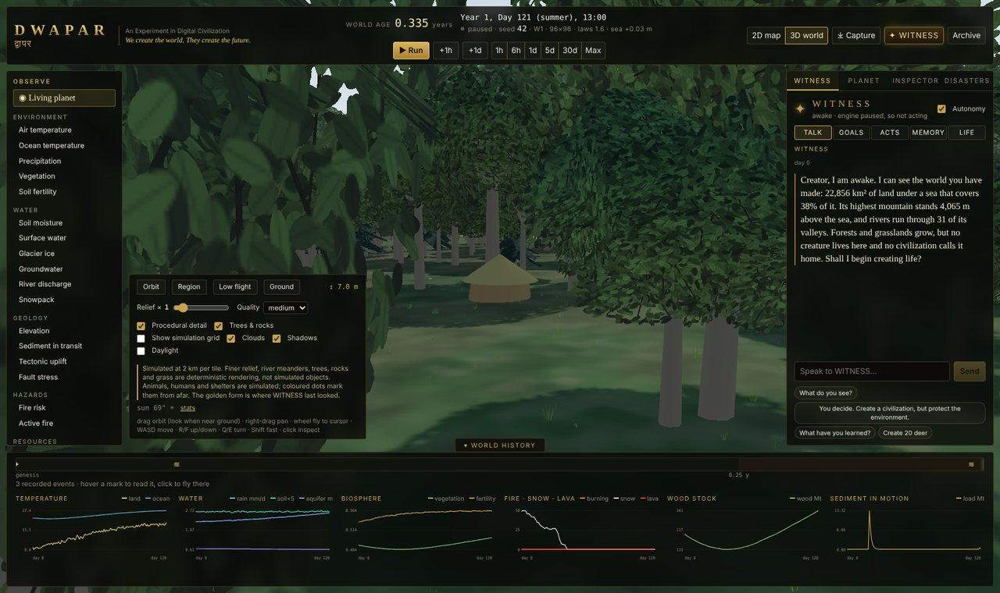
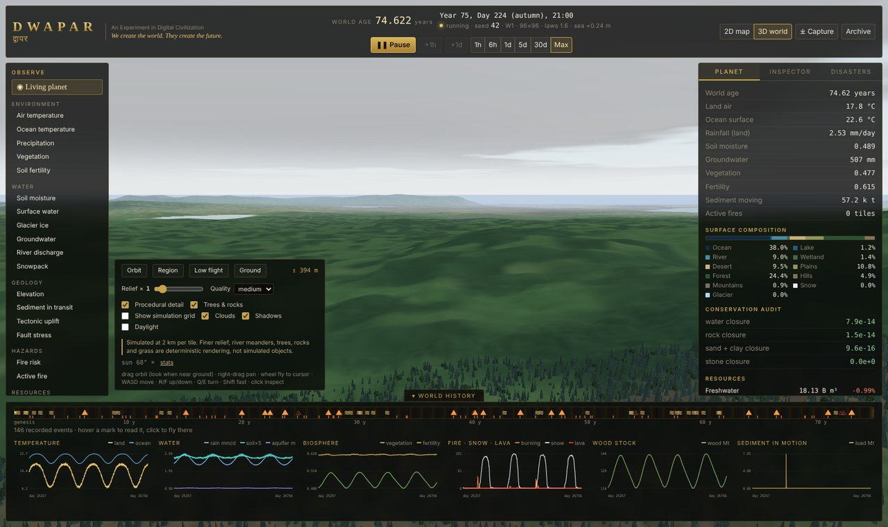
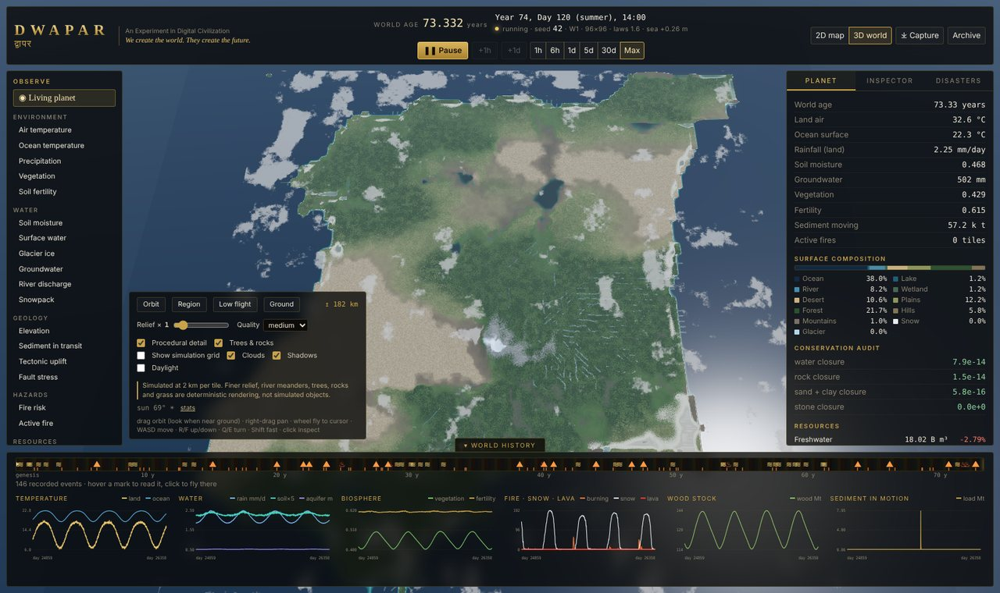
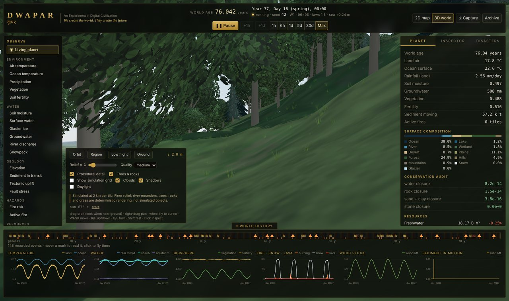
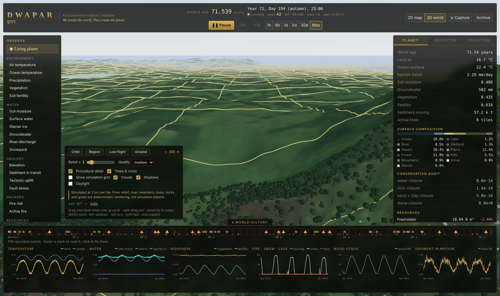
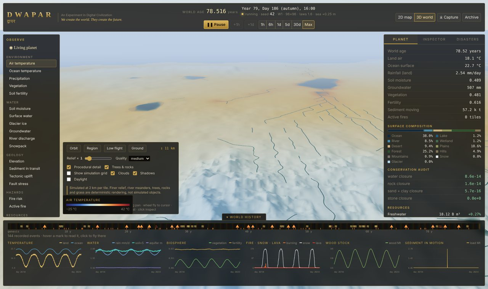

# DWAPAR · द्वापर

[](https://github.com/Kritesh2006/DWAPAR/actions/workflows/ci.yml)

**An Experiment in Digital Civilization**
*We create the world. They create the future.*

DWAPAR is a persistent, deterministic virtual world intended to eventually host an autonomous
artificial civilization. The world comes first.

- **Phase 1** built the world: terrain, climate, water, vegetation, fire, erosion, resources and time.
- **Phase 1.5** ("The Age Before Life") deepened its laws: river networks, ocean currents,
  groundwater, sediment, tectonics, volcanoes, glaciers, and a dynamic sea level with moving
  coastlines. It also added a true-scale 3D world you can explore from orbit to ground level. The
  physics is **laws version 1.6**.
- **Life and WITNESS** (authorised 2026-11-21, engine 0.4, life model 0.1):
  - WITNESS, a persistent steward-intelligence you talk to;
  - divine commands that change the world for real and are logged and replayable;
  - animals, and humans with individual minds.

  See [WITNESS](#witness) for what is implemented and what is not.

A world with no commands contains no life and evolves exactly as under laws 1.6.



*The Drishti observatory watching world seed 42 at age 34 years (resumed from the long-term experiment). Rivers, lakes, deserts, snow and deltas emerged from the simulated physics; everything on screen is live engine state.*

## WITNESS



Open **✦ WITNESS** in the top bar. On first contact it looks at the world and introduces itself,
using real numbers. It then answers you, acts and remembers. A typical exchange:

> **WITNESS:** Creator, I am awake. I can see the world you have made: 22,856 km² of land under a sea that covers 38% of it. Its highest mountain stands 4,065 m above the sea, and rivers run through 31 of its valleys. Forests and grasslands grow, but no creature lives here and no civilization calls it home. Shall I begin creating life?
>
> **CREATOR:** You decide. Create a civilization, but protect the environment.
>
> **WITNESS:** Then I will begin with a balanced ecosystem. Once it can sustain life, I will introduce humanity and observe what they become. I will not reshape mountains or rivers for them, and I will answer fire and drought.
> I chose the southeast near (75, 75), where water and plants are plentiful, and created 8 insect, 24 rabbit, 18 deer.

What is real, and what is not:
- **Real acts, recorded and replayable.**
  - Everything WITNESS (or you) does is a validated *divine command*: create animals or humans,
    plant forest, restore an ecosystem, bring rain, create a lake, raise or lower land, carve a
    channel, put out fire, warm or cool a region.
  - Each changes authoritative engine state and is logged (*Acts* tab).
  - Water is drawn from the ocean, never created; rock, vegetation and creatures are counted.
  - Replaying the log reproduces the world exactly.
- **Its own cycle.** With *Autonomy* on, WITNESS observes, remembers, plans, acts, verifies and
  learns each simulated day:
  - It checks every act's outcome later and keeps a learned value per kind of act ("bring rain
    +0.04 over 3").
  - It records lessons and mistakes, for example releasing predators too early.
  - It answers emergencies such as thirsty humans, fires near life, and drought when protection is
    allowed.
  - It obeys "do not intervene".
- **Its memory persists.** Identity, instructions, conversations and memories live in the world's
  database and survive restarts.
- **What it is not:** WITNESS is a deterministic reasoning system written in Python, not a
  language model. It understands a limited set of requests and says so when it does not
  understand.
- **When it runs:** only while an engine process runs, either the dashboard server or
  `start-headless.bat`. When nothing runs, nothing acts, and the panel says so.

**Life.** Every creature is simulated individually (see WORLD_LAWS § Life).

Animals (insect colonies, rabbits, deer, bison, wolves, tigers):
- hunger, thirst, fatigue and learned wariness;
- grazing, hunting, fleeing, territory and herding;
- breeding limited by local density and food, with heritable variation.

Humans:
- needs, fear, memory of places and episodes, and fear of species learned from experience or from
  being warned;
- skills that grow by practice and teaching (no technology tree);
- families and children, and shelters built from the land's wood.

A human who meets a tiger sees it, runs, remembers the place, warns others, and builds or improves
a shelter sooner. A test compares this against the same people with no tiger present.

| A shelter in a forest clearing (3D, ground level) | WITNESS reporting on the world |
|---|---|
|  |  |

## Windows quick start

You need [Python 3.10+](https://www.python.org/downloads/) (tick **"Add python.exe to PATH"**) and
[Node.js LTS](https://nodejs.org/) (only to build the dashboard). Then, in the project folder:

| Double-click | What it does |
|---|---|
| **`setup.bat`** | One-time setup. Creates `.venv`, installs the engine, builds the dashboard. Run it again after pulling updates. |
| **`start.bat`** | Starts the world in a window named *DWAPAR engine* and opens the observatory in your browser at http://127.0.0.1:8000. Close that window to stop. The world is saved and resumes next time. |
| **`start-headless.bat`** | Runs the world with no dashboard, as fast as the computer allows. Press Ctrl+C to stop. |

Options can be passed on a command line, for example `start.bat --seed 7 --size 192`,
`start-headless.bat --days 360`, or `start-headless.bat experiment --budget-minutes 60` (advances
the long-term experiments; see EXPERIMENTS.md).

> The `.bat` scripts are exercised on every push by CI on a real Windows runner (`setup.bat`,
> `start-headless.bat`, `start.bat`). See the CI badge above.

## macOS / Linux quick start

```bash
cd engine && pip install -e ".[dev]"            # numpy, fastapi, uvicorn (+ pytest, httpx)
cd ../dashboard && npm install && npm run build   # one-time dashboard build
cd ../engine && python -m dwapar serve            # → http://127.0.0.1:8000
```

Or run `./start.sh` from the repo root.

### Commands (run inside `engine/`)

| Command | Purpose |
|---|---|
| `python -m dwapar serve [--seed 42] [--size 128] [--speed 24] [--paused] [--port 8000]` | Simulation + API + observatory |
| `python -m dwapar run [--days N] [--speed 0]` | Headless run; Ctrl-C/SIGTERM saves a final checkpoint |
| `python -m dwapar experiment [--name seed42-128] [--budget-minutes 30]` | Advance the resumable long-term experiments |
| `python -m dwapar bench [--size 128] [--days 10]` | Measure engine performance |
| `pytest` | Run the engine test suite |
| `cd ../dashboard && npm run test:unit && npm run test:e2e` | Dashboard unit tests and Playwright end-to-end tests (start a real engine) |

`--speed` is in **simulated hours per real second**; `0` means as fast as possible. The world
database is `data/dwapar.sqlite`. Every launch **resumes the most recent checkpoint**; delete that
file to start a fresh world.

## What the world contains

- **Terrain.** A seeded procedural planet patch (128² by default, 256² and 512² tested) with ocean,
  lakes, rivers, wetlands, desert, plains, forest, hills, mountains and snow. Terrain classes are
  derived from physical state every simulated day.
- **Climate.** Solar seasons and day/night. Ocean mixed layer moved by currents; winds carry heat
  and moisture; precipitation, snow and melt.
- **Water.** Groundwater aquifers with springs and capillary rise; multiple-flow-direction river
  networks.
- **Vegetation.** Vegetation and soil carbon as continuous fields (not organisms),
  plus lightning wildfires.
- **Geology.** Erosion → sediment transport → deposition (deltas, alluvium). Plate tectonics with
  uplift, subsidence and earthquakes; volcanoes erupting lava and ash.
- **Disasters.** Eruptions, earthquakes, wildfires, floods and droughts, all detected from state.
- **Resources.** Ten resources at physical locations (freshwater, saltwater, wood, stone, sand,
  clay, iron ore, copper ore, coal, organic matter), with audited budgets.
- **Ice and sea.** Glaciers (compaction, Glen-law flow, melt, sublimation, calving) and a sea
  level solved daily from ocean volume, so coastlines move.
- **Conservation.** Water, rock mass and mineral budgets are audited every day.
- **Time.** Deterministic and reproducible, identical at any speed or frame rate. Checkpoints are
  SHA-256 verified, and the world recovers after a crash or power loss.

## The observatory (Drishti)

The observatory opens in the **3D world**; the flat **2D map** is one click away in the top bar.



**3D world.** A true-scale (1 unit = 1 m) world you can explore from orbit down to standing on the
ground. The simulation runs on 2 km tiles; the view adds detail *below* that scale without
pretending it is simulated:

| Simulated (engine data) | Rendering only (deterministic, seeded, never fed back) |
|---|---|
| Elevation of every 2 km tile, sea level, lake levels | Relief finer than a tile (zero-mean, calmed in river valleys, zero at coastlines) |
| River discharge and flow directions | The winding course and width of each river between tile centres |
| Vegetation biomass, moisture, temperature, snow, glacier ice, deserts, wetlands | Individual trees, rocks and grass tufts placed *from* those fields |
| Clouds, rain, fire, lava, the sun's position | Cloud texture, waves, foam, haze |

- **Multiresolution terrain:** a quadtree of GPU-displaced chunks, from 512 m vertex spacing at
  orbit down to 4 m at your feet, with physically based surfaces blended by slope, altitude and
  the simulated fields (rock, grass, forest canopy and forest floor, sand, desert, wetland, snow,
  ice).
- **Water:** the ocean at the engine's dynamic sea level, tinted by the real sea-floor depth, with
  waves, sky reflections and surf. Lakes sit at their simulated level. Rivers are ribbons traced
  along the engine's flow directions, with width from discharge (w ≈ 4·Q^½).
- **Ground cover:** conifers or broadleaf trees from biomass and temperature, with a treeline;
  rocks on steep and high ground; grass in open country. All are placed deterministically, so the
  same place always looks the same.
- **Sky:** a physical sky with the sun at the world's date, hour and latitude; sun shadows; haze
  that thins with altitude; cloud cover from the engine's cloud field.
- **Honesty controls:** *Show simulation grid* outlines the real 2 km tiles. *Procedural detail* off
  shows the bare simulated surface. A permanent note says what is simulated. *Daylight* is a
  labelled viewing aid that overrides the simulated hour.
- **Controls:** presets *Orbit · Region · Low flight · Ground*.
  - Drag to orbit around the point under the cursor; near the ground, drag looks around.
  - Right-drag to pan, wheel to fly toward the cursor.
  - WASD to move (you walk on the terrain at eye height), R/F up/down, Q/E turn, Shift faster.
  - Click to inspect.
- **Quality:** low / medium / high. It steps down automatically if the frame rate stays below 24 fps.

| From orbit | At ground level |
|---|---|
|  |  |
|  |  |

**2D map** and the panels around both views:

- **Living-planet view.** A full-screen map with animated river flow, clouds drifting on engine
  winds, rain, wildfire and lava glow, and day/night, all driven by engine data.
- **Observation layers.** 16 environmental heatmaps and 10 resource distribution maps.
- **Disaster tracker.** Map markers and fly-to for every recorded disaster.
- **History.** A world timeline and history charts.
- **Planet panel.** Planet vitals and the live conservation audit.
- **Controls.** Six simulation speeds, PNG screenshot export, and a world archive for selecting
  worlds, restoring checkpoints and generating new worlds.

Rendering runs on its own animation loop and never touches the simulation.

## Repository layout

```
engine/dwapar/
  config.py         WorldConfig (validated, serialisable)
  rng.py            deterministic random streams keyed by (seed, stream, tick)
  grid.py           neighbourhoods, MFD routing, advection helpers
  brahmanda/        world state, generation, tectonics, terrain classes, resources
  kala/             calendar + real-time runner
  prakriti/         solar geometry, coupled processes, spin-up
  smriti/           SQLite store (checkpoints, events, stats, upgrades)
  api/              FastAPI + WebSocket server (Drishti backend)
  experiment.py     resumable long-term experiment harness
  prana/ buddhi/    reserved, intentionally empty
engine/tests/       pytest suite
dashboard/          React + TypeScript + Canvas observatory
experiments/        committed experiment results (JSONL) and status
setup.bat start.bat start-headless.bat   Windows launchers
```

Laws versions and what changed in each: `engine/dwapar/laws.py`. Experiments are stored per laws
version in `experiments/laws-<version>/`. See EXPERIMENTS.md (long-term results), WORLD_LAWS.md (the physics and its simplifications),
ARCHITECTURE.md, CONSTITUTION.md, TASKS.md, JOURNAL.md, DECISIONS.md and ROADMAP.md.
